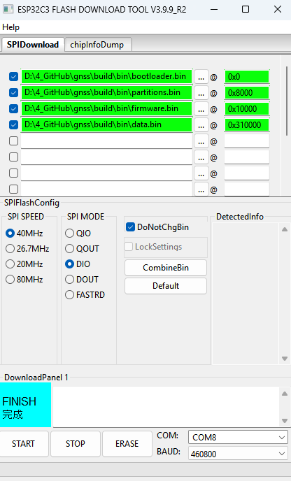
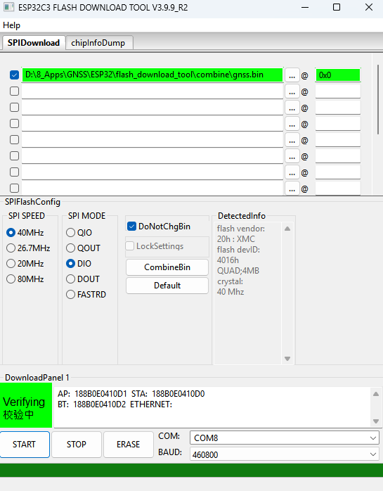
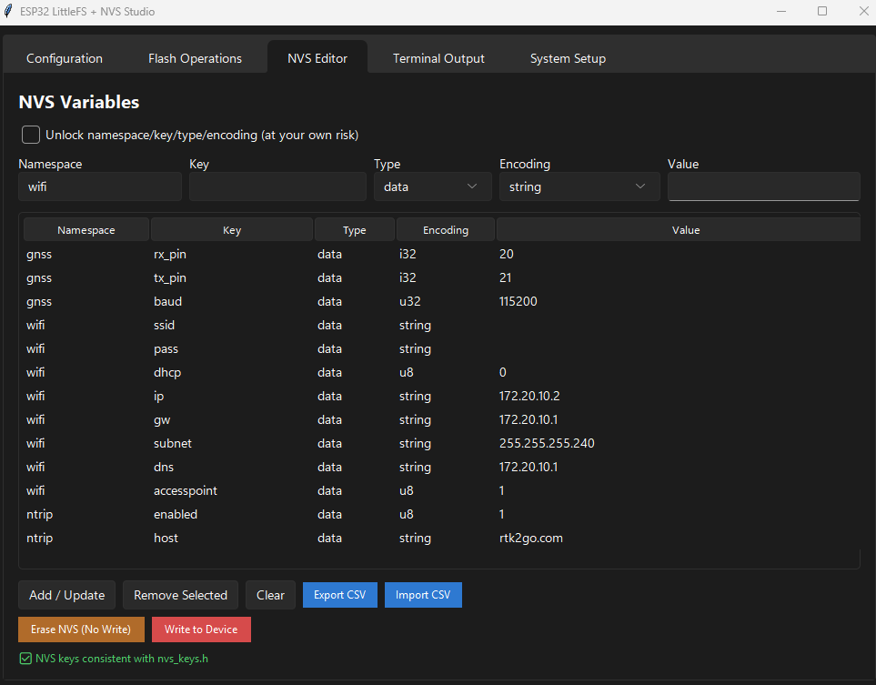

# Installation & Quickstart

## QuickStart: Flashing A Prebuilt Binary

Use this when you want the fastest bring-up without building locally.
Prebuilt images are attached to each [release](https://github.com/entr0-pi/gnss/releases/latest).

> **Shortcut:** search your board in the [board compatibility finder](https://esp32.entr0-pi.com/).
> It tells you the exact file to download. Steps 1 to 4 below explain the same choice by hand.

What you need:
- A GNSS receiver (u-blox, Unicore...) with a UART output
- An **ESP32, ESP32-S3 or ESP32-C3 board** with at least 4 MB of flash
- A USB cable for flashing and powering the board
- A flash tool (`esptool`, or the Espressif Flash Download Tool)
- The [ESP32 NVS Key-Pair Manager](https://github.com/entr0-pi/arduino-nvs-desktop/releases) desktop app (Windows, Linux, macOS) for the first configuration

### 1. Pick your chip

The chip name is printed on the metal shield of the module (for example `ESP32-C3-MINI-1` or
`ESP32-S3-WROOM-1`) or in your board's documentation.

| Chip | CPU | Bootloader offset |
|------|-----|-------------------|
| ESP32 | Xtensa dual-core, 240 MHz | `0x1000` |
| ESP32-S3 | Xtensa dual-core, 240 MHz | `0x0` |
| ESP32-C3 | RISC-V single-core, 160 MHz | `0x0` |

Your board needs at least 4 MB of flash.

> An image only runs on the chip it was built for. Match the **chip**, not just the bootloader offset.

### 2. Find your USB port type (ESP32-S3 and ESP32-C3 only)

The USB port you plug into is wired in one of two ways. The firmware sends its logs and the
[USB configuration](#usb-configuration) to only one of them, so pick the image that matches your port.
With the wrong image the board still boots, but nothing comes out of the USB port and the desktop app
can't connect.

| | **UART** image (`_uart`) | **Native USB** image (`_usb`) |
|---|---|---|
| How the port is wired | Through a USB-to-UART chip (CP2102, CH340, CH9102...) | Directly to the ESP32's own USB pins |
| What you see on the board | A small extra chip near the USB connector | Nothing between the connector and the ESP32 module |
| Windows Device Manager shows | "Silicon Labs CP210x..." or "USB-SERIAL CH340" | "USB Serial Device" or "USB JTAG/serial debug unit" |
| Linux `lsusb` shows | `10c4:ea60` (CP210x) or `1a86:7523` / `1a86:55d4` (CH340 / CH9102) | `303a:1001` (Espressif) |
| Example boards | ESP32-S3-DevKitC-1 (port marked **UART**), ESP32-C3-DevKitM-1 | Lolin C3 Mini, Seeed XIAO ESP32-C3 / S3, ESP32-S3-DevKitC-1 (port marked **USB**) |

- **Two USB ports** (like the ESP32-S3-DevKitC-1): either image works, as long as you use the matching port.
- **ESP32**: this chip has no native USB, so there is only one image and nothing to choose.
- **Not sure?** Plug the board in and check Device Manager or `lsusb`. That is the most reliable test.

### 3. Pick your variant

| Feature | BLE only | Wi-Fi |
|---------|:--------:|:-----:|
| BLE (Nordic UART Service) bridge | ✅ | — |
| USB serial configuration | ✅ | ✅ |
| TCP bridge on port **52148** | — | ✅ |
| Web UI | — | ✅ |
| NMEA parsing (position, satellites, skyplot in the Web UI) | — | ✅ |
| NTRIP client (RTK corrections) | — | ✅ |
| **Best for** | Phone or tablet apps, RTK provided by the device | Standalone RTK rover, browser dashboard |

With the BLE variant, the app (SW Maps, QField...) can supply the RTK corrections. The BLE link forwards
RTCM bytes to the GNSS over UART.

### 4. Pick your file

The file name is `gnss_<VARIANT>_<chip>[_<port type>].bin`:

| Chip | USB port type | BLE only | Wi-Fi |
|------|---------------|----------|-------|
| ESP32 | (only one) | `gnss_BLE_esp32.bin` | `gnss_WIFI_esp32.bin` |
| ESP32-S3 | UART | `gnss_BLE_esp32s3_uart.bin` | `gnss_WIFI_esp32s3_uart.bin` |
| ESP32-S3 | Native USB | `gnss_BLE_esp32s3_usb.bin` | `gnss_WIFI_esp32s3_usb.bin` |
| ESP32-C3 | UART | `gnss_BLE_esp32c3_uart.bin` | `gnss_WIFI_esp32c3_uart.bin` |
| ESP32-C3 | Native USB | `gnss_BLE_esp32c3_usb.bin` | `gnss_WIFI_esp32c3_usb.bin` |

Example: a **Lolin C3 Mini** (ESP32-C3, native USB) used with a phone app over Bluetooth needs
`gnss_BLE_esp32c3_usb.bin`.

Each file is a **merged image**: bootloader, partition table, firmware and Web UI (LittleFS) in one file.

### 5. Flash

```bash
pip install esptool
python -m esptool --chip esp32c3 --port <PORT> write-flash 0x0 gnss_BLE_esp32c3_usb.bin
```

Change the chip, the file name and `<PORT>` (`COM5`, `/dev/ttyUSB0`...) to match your board.
**Merged images always go at `0x0`**, because the bootloader is already at the right offset inside the file.
The Espressif Flash Download Tool works too.

<p>
  &nbsp;
  
</p>

<details>
<summary>Flashing separate files instead</summary>

Only the bootloader offset depends on the chip (other offsets come from `partitions.csv`):

| File | ESP32 | ESP32-S3 | ESP32-C3 |
|------|-------|----------|----------|
| bootloader | `0x1000` | `0x0` | `0x0` |
| partitions | `0x8000` | `0x8000` | `0x8000` |
| firmware | `0x10000` | `0x10000` | `0x10000` |
| data (LittleFS) | `0x310000` | `0x310000` | `0x310000` |

```bash
# ESP32: bootloader at 0x1000
python -m esptool --chip esp32 --port <PORT> write-flash \
  0x1000 bootloader.bin 0x8000 partitions.bin 0x10000 firmware.bin 0x310000 data.bin

# ESP32-S3 / ESP32-C3: bootloader at 0x0
python -m esptool --chip esp32s3 --port <PORT> write-flash \
  0x0 bootloader.bin 0x8000 partitions.bin 0x10000 firmware.bin 0x310000 data.bin
```

A bootloader flashed at the wrong offset prevents the board from booting. Re-flash at the right offset to recover.
</details>

### 6. First start

After flashing, the firmware boots, seeds default settings in NVS (when the build is not locked), and
starts the features of its variant. The GNSS UART is **unconfigured** on first boot
(`rx_pin=-1`, `tx_pin=-1`, `baud=0`), so no data flows until you set it.

**BLE only**
1. Connect the board over USB and open the desktop app (see [USB configuration](#usb-configuration) below).
2. Set the GNSS UART pins and baud rate, then press reset.
3. Connect your app to the BLE device **`MyGNSS`**.

**Wi-Fi**
1. Connect the board over USB and open the desktop app.
2. Set the GNSS UART, your Wi-Fi network and, if needed, your NTRIP caster, then press reset.
3. Once the board joins your Wi-Fi, open `http://<board-ip>` in a browser. Click the gear icon to change
   the GNSS UART, Wi-Fi or NTRIP settings from the Web UI.
4. TCP clients connect to `<board-ip>:52148`.

> The skyplot and position in the Web UI need the GNSS to output standard NMEA sentences
> (`RMC`, `GGA`, `GSA`, `GST`, `GSV`) on the UART.

### USB configuration

Builds with `SERIAL_CONFIG_ENABLE=1` (both release variants) are configured over the USB cable, without
Wi-Fi, the Web UI or a reflash:
- Download the [ESP32 NVS Key-Pair Manager](https://github.com/entr0-pi/arduino-nvs-desktop/releases) for Windows, Linux or macOS. It is a single file with no install.
- Close any serial monitor or flash tool that holds the port.
- Plug in the board, start the app, pick its COM port and click **Connect**. The app reads the board after a short boot delay.
- Load a schema (`.csv`) or configuration (`.json`), edit the `gnss`, `ntrip` and `wifi` values, review and click **Write to ESP32**.
- NTRIP changes apply within about 5 s. GNSS UART and Wi-Fi changes apply at the next boot. Neither the firmware nor the app reboots the board, so press reset afterwards.
- On Linux, add your user to the `dialout` group to open the port.

Protocol details: [docs/SERIAL.md](docs/SERIAL.md).

**Preload NVS settings (recommended for field deployment):**
- Use `utils/uploader/` to write GNSS/WiFi/NTRIP values to NVS and flash LittleFS web assets.
- See: https://github.com/entr0-pi/arduino-uploader.git


- This avoids going to the webUI just to change target wiring or network values
- Fill with your own paths, COM and board type
- Read the documentation to install the prerequisites

## Building From Source

Use this when you need to:
- use another board/chip,
- change feature flags,
- use another partition,
- modify firmware behavior.

The first two are low-risk (see below). The code support a partition layout (by reading in it) but there is a risk it is not comprehensive. For the last one, of course, it is risky unless you know what you do.

### Step 1: Retargeting to Another Board

The default build targets a ESP32-C3 (Lolin C3 Mini). To switch to a different ESP32 board:

1. Copy `.env.example` to `.env` at the project root
2. Edit the four variables (`TARGET_BOARD`, `TARGET_CHIP`, `TARGET_LABEL`, `TARGET_GNSS`)
3. Run `python utils/board/retarget.py --dry-run` to preview changes
4. Run `python utils/board/retarget.py` to apply

This updates `platformio.ini`, flash scripts, web UI strings, documentation, and bootloader offsets in one step. See `utils/board/BOARD_PORTING.md` for the full guide and available boards.

Supported chips with the Docker build: ESP32, ESP32-S3, ESP32-C3, and ESP32-S2 with `BLE_ENABLE` off (no Bluetooth on this chip).

Flash offsets of the current build target (kept up to date by `retarget.py`):
- `bootloader.bin` -> `0x0`
- `partitions.bin` -> `0x8000`
- `firmware.bin` -> `0x10000`
- `data.bin` -> `0x310000`

### Step 2: Building From Source

Prerequisites:
- Docker installed

**Build with Docker:** 
- change the flags in *platformio.ini*
- adapt the partition in *partition.csv*
- any other modifications in the codebase ***at your own risk***
- see README in /build (full automation in a docker container to make it platform-agnostic). Output in /bin for the binaries and the flash commands
- to build ESP32, ESP32-S3 and ESP32-C3 in one run, use `utils/mass-build/` (see its README)

### Step 3: Producing The Release Binaries

The release ships 10 merged images: 5 chip / USB port combinations × 2 variants. Mass build produces
the 5 combinations of **one** variant per run, so run it once per variant.

**1. Set the variant flags in `platformio.ini`** (`build_flags`):

| Flag | 🔵 BLE only | 📶 Wi-Fi |
|------|:-----------:|:--------:|
| `-DBLE_ENABLE=1` | ✅ | — |
| `-DSERIAL_CONFIG_ENABLE=1` | ✅ | ✅ |
| `-DWEBUI_ENABLE=1` | — | ✅ |
| `-DNMEA_ENABLE=1` | — | ✅ |
| `-DTCP_ENABLE=1` | — | ✅ |
| `-DTCP_PORT=52148` | — | ✅ |
| `-DNTRIP_CLIENT_ENABLE=1` | — | ✅ |

Wi-Fi is enabled automatically by `WEBUI_ENABLE`, `TCP_ENABLE` or `NTRIP_CLIENT_ENABLE`.

**2. Build the 5 combinations:**

```bash
python utils/mass-build/mass_build.py
```

Each combination lands in `build/bin/<NAME>/` with its merged image `gnss_<chip>.bin`:

| `NAME` (folder) | Merged image | Board definition |
|-----------------|--------------|------------------|
| `esp32` | `gnss_esp32.bin` | `esp32dev` |
| `esp32s3_uart` | `gnss_esp32s3.bin` | `esp32-s3-devkitc-1` |
| `esp32s3_usb` | `gnss_esp32s3.bin` | `esp32-s3-devkitc-1` + `ARDUINO_USB_CDC_ON_BOOT=1` |
| `esp32c3_uart` | `gnss_esp32c3.bin` | `esp32-c3-devkitm-1` |
| `esp32c3_usb` | `gnss_esp32c3.bin` | `lolin_c3_mini` |

**3. Copy each merged image to its release name**, `gnss_<VARIANT>_<NAME>.bin` with `<VARIANT>` set to `BLE`
or `WIFI`, in `build/bin/`:

```bash
VARIANT=BLE   # or WIFI
cd build/bin
for d in esp32 esp32s3_uart esp32s3_usb esp32c3_uart esp32c3_usb; do
  cp "$d"/gnss_*.bin "gnss_${VARIANT}_${d}.bin"
done
```

Do this **before** the next mass build run. Each run wipes and rebuilds the `build/bin/<NAME>/` folders, but
the renamed copies in `build/bin/` are kept.

**4. Repeat steps 1 to 3 for the other variant.** You then have the 10 release files:

```text
build/bin/
├─ gnss_BLE_esp32.bin          gnss_WIFI_esp32.bin
├─ gnss_BLE_esp32s3_uart.bin   gnss_WIFI_esp32s3_uart.bin
├─ gnss_BLE_esp32s3_usb.bin    gnss_WIFI_esp32s3_usb.bin
├─ gnss_BLE_esp32c3_uart.bin   gnss_WIFI_esp32c3_uart.bin
└─ gnss_BLE_esp32c3_usb.bin    gnss_WIFI_esp32c3_usb.bin
```

**5. Check before publishing:** flash at least one `_uart` and one `_usb` image of each variant, check that
the desktop app connects, and, for Wi-Fi, that the Web UI and TCP port 52148 answer.

### Recommended Workflow

Recommended workflow:
- Develop and validate UI behavior with `render-web`
- Validate firmware flag combinations with `build-tester`
- Produce deployable config + assets with `uploader`

**Preload NVS settings (recommended for field deployment):**
- See description in the previous section

## Utils 

Available tooling under `utils/`:
- `utils/board/retarget.py`: board retargeting script (see Step 1 above)
- `utils/mass-build/mass_build.py`: Docker build of every supported chip in one run
- `utils/uploader`: NVS editor + writer, LittleFS builder/flasher
- `utils/render-web/render_web.py`: local dev server for `data/web/` with mock API
- `utils/build-tester/build_Tester.py`: build matrix tester for feature flags
- `utils/boards-update/enrich_boards.py`: refreshes the board list behind the [board compatibility finder](https://esp32.entr0-pi.com/)

Utils goals and when to use them:

1. `utils/board/` (board retargeting)
- Goal: switch the entire codebase to a different ESP32 board in one command.
- Reads `.env` and updates configs, build scripts, web UI, and docs.
- Best for: porting to a new board, maintaining multi-board variants.
- Expected outcome: all board-specific references are consistent after running the script.

2. `utils/mass-build/` (release binaries)
- Goal: build one firmware per supported chip and USB port type (ESP32, ESP32-S3 UART/USB, ESP32-C3 UART/USB) with the Docker workflow.
- Applies `retarget.py` for each board, builds, exports the binaries, then restores the working tree.
- Best for: preparing release binaries, checking that every chip still builds.
- Expected outcome: `build/bin/<name>/` (for example `build/bin/esp32c3_usb/`) holds the separate binaries, the merged image and the flash scripts for each chip.
- For the full release (both variants and the file names), see [Step 3: Producing The Release Binaries](#step-3-producing-the-release-binaries).

3. `utils/uploader/` (deployment and field configuration)
- Goal: configure devices without rebuilding firmware.
- Use it to prepare and flash:
  - NVS key/values (GNSS UART, WiFi, NTRIP),
  - LittleFS image (Web UI assets).
- Best for: production setup, installer workflow, lab technicians.
- Expected outcome: device is flashed with firmware-compatible config and web assets in one workflow.

4. `utils/render-web/` (Web UI development loop)
- Goal: iterate quickly on Web UI outside embedded target constraints.
- Serves `data/web/` with mocked API endpoints that mimic firmware routes.
- Best for: frontend work, API contract checks, UI regression checks before flashing.
- Expected outcome: faster UI iteration with no board required for every change.

5. `utils/build-tester/` (compile-time flag validation)
- Goal: verify feature-flag combinations still compile as the project evolves.
- Runs tiered build matrices, including expected-failure guard tests.
- Best for: CI validation, pre-release sanity checks, refactor safety.
- Expected outcome: early detection of broken flag combinations and guard regressions.

6. `utils/boards-update/` (board compatibility finder data)
- Goal: keep the board list used by the [board compatibility finder](https://esp32.entr0-pi.com/) (`docs/index.html`) in sync with PlatformIO.
- Adds new boards from the PlatformIO espressif32 list, removes boards no longer on it, and refreshes their specs (MCU, frequency, flash, RAM, vendor) from the official manifests. Existing firmware mappings are kept.
- Usage: `python utils/boards-update/enrich_boards.py <in.json> <out.json>` (set `GITHUB_TOKEN` to avoid API rate limits).
- Best for: after a PlatformIO platform update, or when a new chip gets prebuilt binaries.
- Expected outcome: an updated JSON to copy over `docs/boards.json`.
