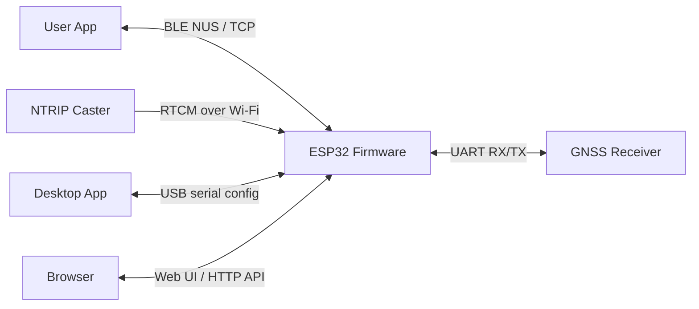
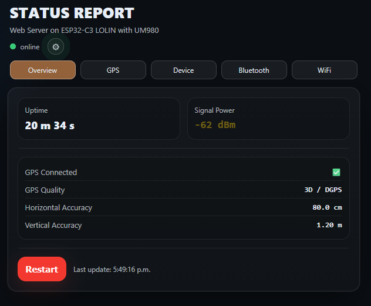
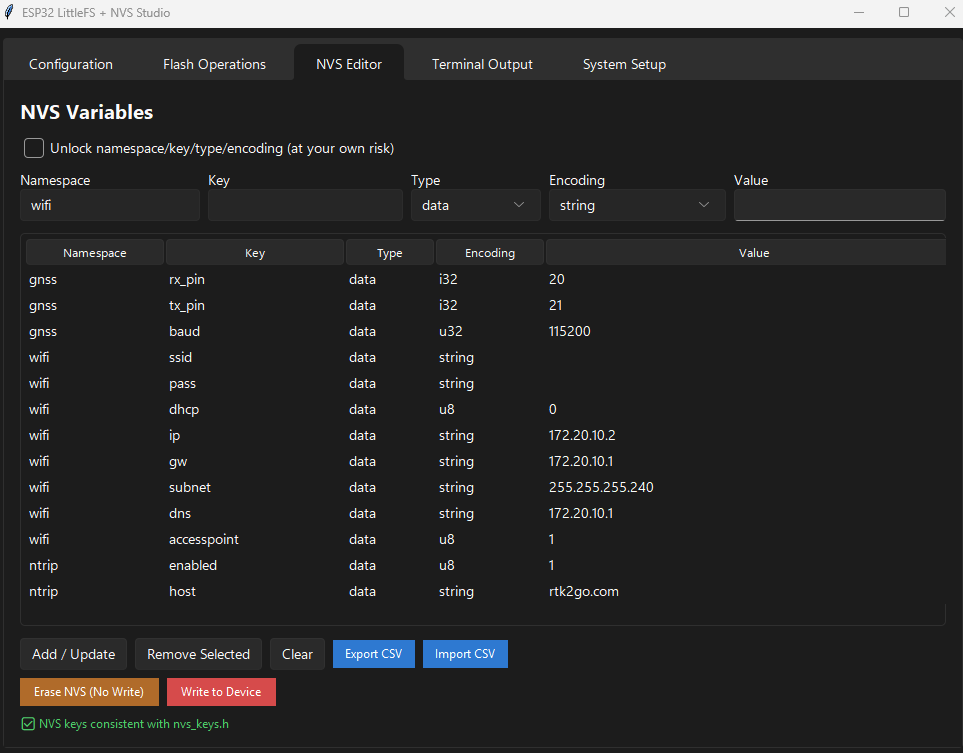

# GNSS ESP32 Bridge

Turn a low-cost ESP32 board into a **wireless bridge for your GNSS receiver**: stream positions over
Bluetooth LE or Wi-Fi, feed RTK corrections from an NTRIP caster, and watch your fix live in the browser.

It can expose raw GNSS serial data over:
- BLE (Nordic UART Service) 🛰️
- TCP socket 🌐

An optional Web UI adds browser-based status and configuration (UART, Wi-Fi, NTRIP). Since v4.0, the board
can also be configured **over USB** with a desktop app, with no Wi-Fi, Web UI or reflash needed.

> **v4.0: ready-to-flash binaries** for ESP32, ESP32-S3 and ESP32-C3, each in a **BLE only** and a
> **Wi-Fi** variant. Get them from the [latest release](https://github.com/entr0-pi/gnss/releases/latest)
> and follow the [QuickStart](INSTALL.md#quickstart-flashing-a-prebuilt-binary).

## Project Overview

This project is GNSS-agnostic firmware for ESP32 boards:
- GNSS input/output on `Serial1` (UART)
- Raw byte passthrough (NMEA and other serial payloads)
- Optional BLE NUS bridge (both ways, an external NTRIP can feeds corrections into GNSS UART, as with SWMaps)
- Optional single-client TCP bridge (to use QField for example)
- Optional Web UI for config + monitoring
- Optional NTRIP client feeding corrections into GNSS UART (needs to be connected to a WiFi with internet access)
- Optional USB serial configuration with the [ESP32 NVS Key-Pair Manager](https://github.com/entr0-pi/arduino-nvs-desktop/releases) desktop app

Design intent:
- Works with different GNSS modules and wiring
- Works across ESP32 variants (ESP32, ESP32-S3 and ESP32-C3 prebuilt; see [Board Retargeting](#board-retargeting))
- Supports runtime-configurable mode and compile-time locked mode

## Installation & Quickstart

### Prebuilt binaries

Choose by **chip**, then by **USB port type** (ESP32-S3 and ESP32-C3 only), then by **variant**:

| Chip | USB port type | Bootloader offset | 🔵 BLE only | 📶 Wi-Fi |
|------|---------------|-------------------|-------------|----------|
| ESP32 | (only one) | `0x1000` | `gnss_BLE_esp32.bin` | `gnss_WIFI_esp32.bin` |
| ESP32-S3 | UART (USB-to-UART chip) | `0x0` | `gnss_BLE_esp32s3_uart.bin` | `gnss_WIFI_esp32s3_uart.bin` |
| ESP32-S3 | Native USB | `0x0` | `gnss_BLE_esp32s3_usb.bin` | `gnss_WIFI_esp32s3_usb.bin` |
| ESP32-C3 | UART (USB-to-UART chip) | `0x0` | `gnss_BLE_esp32c3_uart.bin` | `gnss_WIFI_esp32c3_uart.bin` |
| ESP32-C3 | Native USB | `0x0` | `gnss_BLE_esp32c3_usb.bin` | `gnss_WIFI_esp32c3_usb.bin` |

- **BLE only**: BLE bridge + USB config.
- **Wi-Fi**: TCP (port 52148), Web UI, NMEA parsing, NTRIP client + USB config.
- **USB port type**: if a small USB-to-UART chip (CP2102, CH340...) sits between the USB connector
  and the ESP32, take `_uart`. If the connector goes straight to the ESP32 (Lolin C3 Mini, XIAO...),
  take `_usb`. With the wrong one the board boots, but the USB port stays silent. See
  [how to check](INSTALL.md#2-find-your-usb-port-type-esp32-s3-and-esp32-c3-only).

Each file is a merged image: flash it at `0x0`, for example
`python -m esptool --chip esp32c3 --port <PORT> write-flash 0x0 gnss_BLE_esp32c3_usb.bin`.

See `INSTALL.md` for:
- [choosing and flashing a prebuilt binary](INSTALL.md#quickstart-flashing-a-prebuilt-binary) and the first start,
- [USB configuration](INSTALL.md#usb-configuration),
- retargeting to another ESP32 board,
- building from source,
- utility tooling.

## Architecture & Data Flow



Implemented data paths:
- GNSS -> ESP32 over UART: raw bytes read from `Serial1`
- ESP32 -> BLE client: buffered notifications (when BLE enabled and subscribed)
- BLE client -> ESP32 -> GNSS: writes forwarded to UART (useful for RTCM)
- ESP32 -> TCP client: mirrored raw stream via single TCP client server
- TCP client -> ESP32 -> GNSS: inbound TCP bytes forwarded to UART
- NTRIP client (optional): RTCM stream forwarded to UART
- Desktop app <-> ESP32 over USB (optional): framed NVS config protocol, sharing the port with logs

## GNSS & NMEA Requirements

Base bridge requirement:
- GNSS must output serial data on UART (NMEA typically)
- Firmware forwards raw bytes; it does not require vendor-specific protocol for passthrough

For Web UI satellite/fix panels (when `NMEA_ENABLE=1`):
- NMEA should be standard, checksum-valid sentences
- Parser currently consumes:
  - `RMC` (position/speed/date/time validity)
  - `GGA` (fix quality, sats used, HDOP)
  - `GSA` (fix type, HDOP)
  - `GST` (accuracy estimates)
  - `GSV` (satellites in view for skyplot/list)

If those sentences are missing, corresponding UI fields remain empty/stale.

## Customization (Core Value)

### A) Build-Time (compile-time flags)

Configure in `platformio.ini` / `include/app.h`:
- Feature toggles: `BLE_ENABLE`, `WEBUI_ENABLE`, `TCP_ENABLE`, `NMEA_ENABLE`, `NTRIP_CLIENT_ENABLE`
- Network mode: `WIFI_DUAL_MODE`, `SOFTAP_*`, `STA_CHANNEL`
- Locked production options:
  - `FORCE_HARDCODED_UART` + `HARD_RX_PIN/HARD_TX_PIN/HARD_BAUD`
  - `FORCE_WIFI_SECRETS` (+ `include/secrets.h`)

### B) At Rest (uploader / NVS preloading)

Write device config without recompiling:
- GNSS namespace: `rx_pin`, `tx_pin`, `baud`
- WiFi namespace: `ssid`, `pass`, `dhcp`, `ip`, `gw`, `subnet`, `dns`, `accesspoint`
- NTRIP namespace: caster + lockout fields

Use `utils/uploader/` to manage and flash these values.

### C) Runtime (Web UI)

When `WEBUI_ENABLE=1`, HTTP API/UI can update:
- GNSS UART config (`/api/config`)
- WiFi config (`/api/wifi_config`)
- NTRIP config (`/api/ntrip_config`)

Mode behavior:
- Mutable mode: POST updates are accepted and persisted in NVS
- Locked mode: POST returns `403` when immutable flags are active

WiFi behavior supported by firmware:
- STA mode
- Optional STA+SoftAP dual mode (with NVS flag `wifi/accesspoint`)

### D) Runtime (USB serial)

When `SERIAL_CONFIG_ENABLE=1` (both prebuilt variants), the [ESP32 NVS Key-Pair Manager](https://github.com/entr0-pi/arduino-nvs-desktop/releases)
desktop app (Windows, Linux, macOS) reads, changes and erases the `gnss`, `ntrip` and `wifi` settings over the USB cable:
- `hello` / `get` / `set` / `erase` commands in frames with a CRC16 checksum and a size limit
- Sequence numbers, so a resent request is not applied twice
- Protected settings are refused with clear error codes (read-only, forbidden, not found)
- Log output is ignored by the protocol, so logs and configuration share one port
- NTRIP changes apply within about 5 s. GNSS UART and Wi-Fi changes apply at the next boot (press reset; nothing reboots the board automatically)

See [INSTALL.md](INSTALL.md#usb-configuration) for the steps and [docs/SERIAL.md](docs/SERIAL.md) for the protocol.

## Build Flags Quick Reference

| Flag | Meaning |
|---|---|
| `BLE_ENABLE` | Enable BLE NUS bridge |
| `WEBUI_ENABLE` | Enable Web UI + HTTP API |
| `TCP_ENABLE` | Enable single-client TCP bridge |
| `NMEA_ENABLE` | Enable NMEA parsing for UI (forced off if Web UI off) |
| `NTRIP_CLIENT_ENABLE` | Enable NTRIP client (auto-enables WiFi; build error if `WIFI_ENABLE=0`) |
| `SERIAL_CONFIG_ENABLE` | Enable USB serial configuration for the desktop app |
| `TCP_PORT` | TCP listening port |
| `FORCE_HARDCODED_UART` | Lock UART to build-time pins/baud |
| `FORCE_WIFI_SECRETS` | Lock WiFi settings to `secrets.h` |
| `WIFI_DUAL_MODE` | Enable STA + SoftAP mode |

For the full parameter list and defaults, see `docs/FLAGS.md`, `include/README.md` and `include/app.h`.

The prebuilt variants use these flags:
- **BLE only**: `BLE_ENABLE=1`, `SERIAL_CONFIG_ENABLE=1`
- **Wi-Fi**: `WEBUI_ENABLE=1`, `NMEA_ENABLE=1`, `TCP_ENABLE=1`, `TCP_PORT=52148`, `NTRIP_CLIENT_ENABLE=1`, `SERIAL_CONFIG_ENABLE=1`

## Documentation References

For deeper technical details:
- `include/README.md`
- `include/app.h`
- `src/main.cpp`
- `src/web_ui.cpp`
- `src/nmea_gps.cpp`
- `src/gnss_config.cpp`
- `src/wifi_config.cpp`
- `src/ntrip_client.cpp`
- `src/serial_config.cpp`
- `docs/SERIAL.md`, `docs/SERIAL COMPANION.md`
- `utils/build-tester/README.md`
- `utils/mass-build/README.md`

## Board Retargeting

The default build targets the Lolin C3 Mini (ESP32-C3). To build for a different ESP32 board:

1. Copy `.env.example` to `.env` and set `TARGET_BOARD`, `TARGET_CHIP`, `TARGET_LABEL`, `TARGET_GNSS`
2. Run `python utils/board/retarget.py`

This updates `platformio.ini`, flash scripts, web UI, and documentation in one step. See `utils/board/BOARD_PORTING.md` for details and the [PlatformIO board registry](https://registry.platformio.org/platforms/platformio/espressif32/boards) for available boards.

| Available Chip Family | Buildable with |
|-----------------------|----------------|
| ESP32 | `build/Dockerfile.base` (`espressif32 @ 6.13.0`, Arduino core 2.0.17) |
| ESP32-S2 | `build/Dockerfile.base`, only with `BLE_ENABLE` off (no Bluetooth on this chip). Not in mass build |
| ESP32-S3 | `build/Dockerfile.base` (`espressif32 @ 6.13.0`, Arduino core 2.0.17) |
| ESP32-C3 | `build/Dockerfile.base` (`espressif32 @ 6.13.0`, Arduino core 2.0.17) |
| ESP32-C2, ESP32-C5, ESP32-C6, ESP32-C61, ESP32-H2, ESP32-H4, ESP32-P4, ESP32-S31 | Not supported yet (needs Arduino core 3.x) |

To build ESP32, ESP32-S3 and ESP32-C3 in one run, use `utils/mass-build/` (see `utils/mass-build/README.md`).

## Repository Layout

```text
.
├─ data/                 # LittleFS assets (web files, mock config/status)
├─ include/              # Config headers and module interfaces
├─ src/                  # Firmware implementation
├─ utils/board/          # Board retargeting script
├─ utils/mass-build/     # Docker build of every supported chip in one run
├─ utils/uploader/       # NVS + LittleFS uploader GUI
├─ utils/render-web/     # Web UI local dev server
├─ utils/build-tester/   # Build matrix tester + Dockerfile
├─ .env.example          # Board retargeting template
├─ partitions.csv
├─ platformio.ini
└─ README.md
```

## Some pictures...

<p>
  &nbsp;
  &nbsp;
  
</p>
