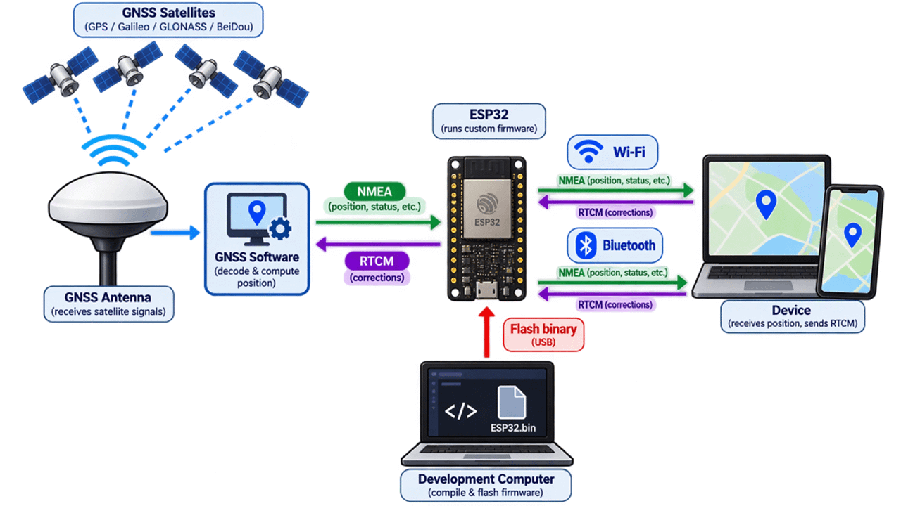
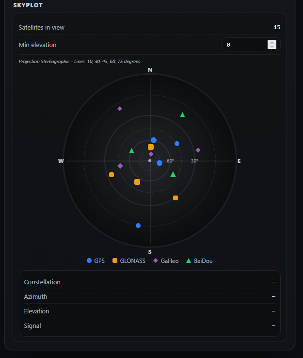

# GNSS ESP32 Bridge

Turn a low-cost ESP32 board into a **wireless bridge for your GNSS receiver**: stream positions over
Bluetooth LE or Wi-Fi, feed RTK corrections from an NTRIP caster, and watch your fix live in the browser.

  
   
  <em>From satellite signals to your device — the GNSS ESP32 Bridge at a glance.</em>

## Features

- Works with any GNSS receiver that has a UART output (u-blox, Unicore...)
- Raw byte passthrough both ways, so RTK corrections reach the receiver
- **BLE** bridge for phone and tablet apps (SW Maps, QField...)
- **Wi-Fi**: TCP bridge, Web UI with live position and skyplot, built-in NTRIP client
- Configuration over **USB** with the [ESP32 NVS Key-Pair Manager](https://github.com/entr0-pi/arduino-nvs-desktop/releases) desktop app, with no reflash needed

## Get Started

1. Find the right file for your board with the **[board compatibility finder](https://esp32.entr0-pi.com/)**.
2. Download it from the [latest release](https://github.com/entr0-pi/gnss/releases/latest).
3. Flash it in your browser with the [Espressif web tool](https://espressif.github.io/esp-launchpad/).
4. Set the GNSS UART pins (and Wi-Fi / NTRIP) with the desktop app, then press reset.

Step-by-step guide: [INSTALL.md](INSTALL.md#quickstart-flashing-a-prebuilt-binary).

Need RTK corrections? Find a free nearby base station with the [RTK2go station finder](https://rtk2go.entr0-pi.com/).

## Documentation

| Topic | Where |
|---|---|
| Choosing, flashing and configuring a prebuilt binary | [INSTALL.md](INSTALL.md) |
| Building from source, other boards, release binaries | [INSTALL.md](INSTALL.md#building-from-source), [utils/board/BOARD_PORTING.md](utils/board/BOARD_PORTING.md) |
| Build flags | [docs/FLAGS.md](docs/FLAGS.md) |
| Architecture, data paths, Web UI API, repository layout | [docs/DIAGRAM.md](docs/DIAGRAM.md) |
| USB configuration protocol | [docs/SERIAL.md](docs/SERIAL.md) |
| Contributing | [CONTRIBUTING.md](CONTRIBUTING.md) |

## Web UI

  &nbsp;
  &nbsp;

