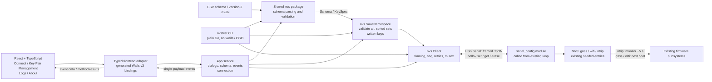
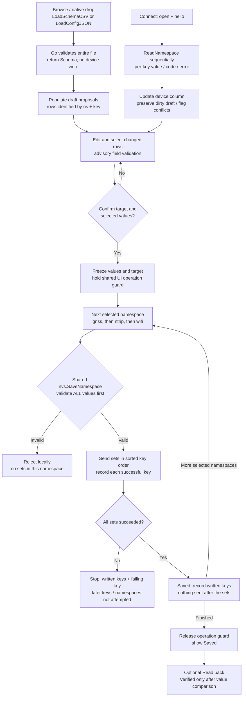
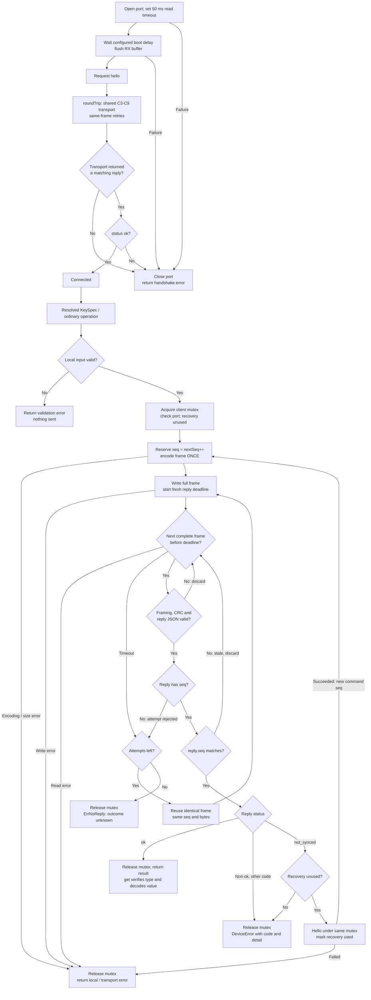
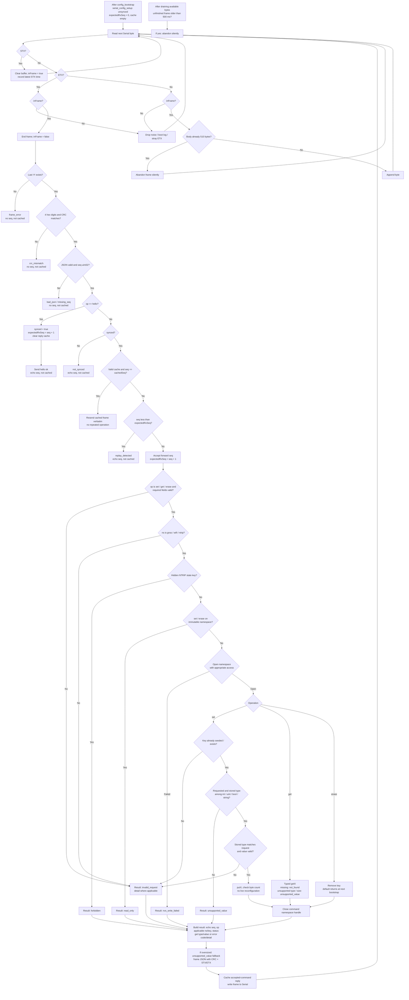
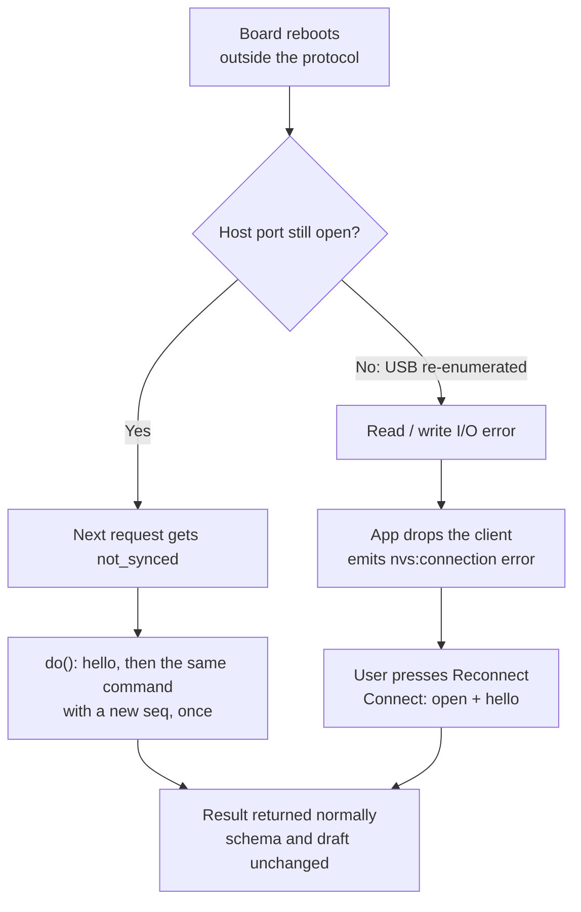
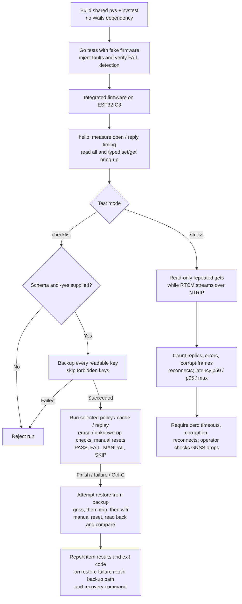

# ESP32 GNSS configuration: integrated communication flow

> **Status: integrated design reference.** This document summarizes the version specified by the guides below. It replaces the standalone, single-`config`-namespace graph; it does not certify implementation or hardware acceptance. `arduino.cpp` remains the standalone source to adapt, and `wails.go` / `schema.go` supply the backend source to split and reuse.

| Reference | Responsibility |
|---|---|
| [GNSS_INTEGRATION.md](GNSS_INTEGRATION.md) | Firmware module, validation policy, when changes take effect, and firmware acceptance |
| [FIRMWARE_TESTER.md](FIRMWARE_TESTER.md) | Wails-free shared Go backend and `nvstest` tester |
| [WAILS_GO.md](WAILS_GO.md) | App API, schema, namespace save, errors, and connection |
| [WAILS_FRONTEND.md](WAILS_FRONTEND.md) | Wails v3 / React UI, native file flows, events, and user confirmation |
| [Implementation prompts](Others/IMPLEMENTATION_PROMPTS.md) | Execution order: stage 1 GNSS integration → stage 2 Go backend/tester and firmware acceptance → stage 3 full Wails app |

Backend semantics follow WAILS_GO.md; Wails host integration follows the v3 frontend guide. The shared-package layout in FIRMWARE_TESTER.md supersedes the earlier monolithic desktop layout. Firmware assumptions and approval workflow remain in GNSS_INTEGRATION.md.

## Shared architecture



The firmware receives requests only, never the CSV/JSON schema. The shared `nvs/` package owns protocol, schema, and save logic; `cmd/nvstest/` uses it without an App service or frontend. The full app later adds `app.go`, `main.go`, and `frontend/`, preserving the same backend and tester. See FIRMWARE_TESTER.md for exports, layout, version pins, and tests.

Firmware integration is gated by `SERIAL_CONFIG_ENABLE` (default `0`). When enabled, existing initialization sets the 1024-byte RX buffer before `Serial.begin()`, runs `config_bootstrap()`, then `serial_config_setup()`; the existing loop calls `serial_config_poll()`. No second Arduino `setup()`, `loop()`, or `Serial.begin()` is added.

## Wire format and messages

`STX (0x02) + JSON payload + '#' + CRC16 (4 hex digits) + ETX (0x03)`

- CRC16-CCITT: polynomial `0x1021`, initial `0xFFFF`, no reflection/final XOR, computed over JSON bytes only. Send uppercase hex; receivers accept either case and split on the last `#`.
- Maximum total frame: **512 bytes**; body: 510 bytes; JSON: at most 505 bytes. Control bytes are escaped in JSON. Fresh STX restarts reception; noise outside frames and oversized frames are discarded.
- Go rejects an oversized encoded request with `ErrFrameTooLarge` before sending. A 256-byte string can still exceed the frame limit after escaping. An oversized firmware reply becomes a short `unsupported_value` error retaining seq.
- Transport is **115200 8N1**; the baud setting is ignored by native USB-CDC. It is independent of the GNSS `gnss/baud` setting on Serial1.

Every request carries `op` and a uint32 `seq`.

| Operation | Additional request fields | Successful result |
|---|---|---|
| `hello` | None | Echo seq, `op: "hello"`, `status: "ok"`; synchronize and clear cache |
| `set` | `ns`, `key`, `type`, `value` | Store an existing key with the same NVS type; nothing is applied live by the module |
| `get` | `ns`, `key` | Return `type` and `value` |
| `erase` | `ns`, `key` | Remove key; at the next boot, bootstrap re-seeds the **whole namespace** with defaults (see "GNSS firmware specifics") |

Normal replies carry `seq`, `op`, applicable `ns` / `key`, and `status` (`ok` / `error`). Errors use `message` for the machine-readable code and optional `detail` for a human-readable reason. Missing detail means an empty string. Frame errors omit seq; sequence errors echo seq but need not include op/ns/key. The oversized-reply fallback can also omit op/ns/key.

These four are the only operations, as in `arduino.cpp`. Any other `op`, including `apply` or `restart`, returns `invalid_request`. The protocol only stores values: `ntrip` changes are picked up by the firmware's monitor within ~5 s, and `gnss` / `wifi` changes at the next boot (reset button, power cycle or web UI restart; GNSS_INTEGRATION.md §4).

| Protocol type | NVS type | Value |
|---|---|---|
| `int` | `PT_I32` | Signed int32 |
| `uint` | `PT_U32` | Unsigned uint32 |
| `bool` | `PT_U8` | JSON boolean |
| `string` | `PT_STR` | String of at most 256 bytes |

Keys are 1–15 bytes; Go rejects NUL in keys and string values. Integrated configuration supports only these four types. Firmware rejects float and other unsupported NVS types with `unsupported_value`; the standalone sketch's float/blob support is not part of this contract.

Example set and validation refusal:

```json
{"op":"set","seq":12,"ns":"gnss","key":"baud","type":"uint","value":230400}
```

```json
{"seq":13,"op":"set","ns":"gnss","key":"baud","status":"error","message":"invalid_request","detail":"type mismatch: uint expected"}
```

## Schema, draft, and namespace save

Go parses both CSV schemas and version-2 JSON configurations into `Schema{keys, proposed}`. Imports work offline and send nothing to the device. Files are at most 64 KiB, with at most 100 keys; CSV encodings map `i32/u32/u8/string` to the four protocol types. JSON requires version 2 and typed values. Parser details and rejection rules remain in WAILS_GO.md.

CSV empty value cells mean **no proposal**. JSON `""`, `false`, and `0` are actual values. The frontend keeps draft values separate from last-read device values, preserves dirty edits on read/reconnect, and marks conflicts rather than overwriting edits. Loading a replacement file with dirty edits requires confirmation.



`SaveResult` is `{written}`. Rejected promises carry structured `{code, detail, op?, ns?, key?, written?}`; partial results are in the error because the promise has no successful return value. The adapter reads structured `error.cause` first, then parses `error.message`. There is no rollback or automatic retry of a partly completed namespace.

`ReadNamespace` reports per-key refusals without inventing values. `forbidden` rows are excluded from writes and export; `read_only` disables a namespace after a refused mutation. Read-only state is not discovered by successful reads. Erase is a confirmed device action: until reboot the key is Not stored and set is refused, and at the next boot every key of that namespace returns to its default. Clear draft is a separate local action.

`SaveConfigJSON` exports version 2 through a native Save dialog in schema order. The frontend confirms the clear-text-password export and excludes inaccessible rows; Go validates the supplied values. Cancelled import/export dialogs leave current state unchanged. See the frontend guide for the full interaction rules.

## Go client: handshake and ordinary requests

This flow covers typed set/get/erase calls. Hello uses the same framed round trip; the tester's Exchange is a separate caller described below. A client mutex permits one request in flight. Each new Client starts seq at 0; hello/resync advances that same counter.



Default timings are 2 s boot delay, 1 s per-attempt reply deadline, and 3 attempts. Native USB may not reset on open; measure before shortening boot delay. Serial reads poll every 50 ms, including `0, nil` reads, so deadlines are approximate to that interval. The deadline starts after writing and is not a write timeout. Corrupt/stale frames wait under the same deadline; timeout or a readable no-seq reply consumes an attempt. I/O failures return immediately.

Ordinary `do()` performs hello plus one new command round trip after the first matching `not_synced`. A second refusal returns to the caller. Matching `replay_detected` is a device error; only different-seq replies are discarded as stale. Exhausted attempts leave command outcome unknown.

## Firmware receiver, policy, and effects

The following replaces the old always-open `config` namespace and permissive type-changing set path. Namespace handles are opened/closed per command; a failed open returns `nvs_write_failed`. Field validation is followed by the policy order namespace → hidden key → immutable mutation → existing key/type for set.



Every early reply is framed with the same CRC format and resumes reception. Hello, frame-level errors, `not_synced`, and `replay_detected` do not replace the cache. Accepted-command successes **and errors** are cached. G4 compares seq only: even a different body with the cached seq receives the old frame.

Namespace handles must also be closed on errors after a successful open; arrows to error nodes abbreviate that cleanup. The frame timer is checked after draining serial input, not as a per-byte idle timer.

Hidden keys are `ntrip/lock_fails`, `ntrip/lock_aband`, and `ntrip/lock_hash`, using the real firmware constants. Other configuration keys, including passwords, remain readable. Every settable key must be seeded with its loader's NVS type; no arbitrary key creation or type replacement is allowed. Verify bootstrap coverage and actual immutable macros in the firmware repository as required by the integration guide.

### GNSS firmware specifics

Verified against this repository (`src/serial_config.cpp`, `src/config_bootstrap.cpp`):

- **Hidden keys** use `nvs_keys::ntrip::lockout::kAttempts`, `kAbandoned` and `kHash`.
- **Immutable namespaces** come from `app.h`: `gnss` when `FORCE_HARDCODED_UART=1`, `wifi` when `FORCE_WIFI_SECRETS=1` or WiFi is disabled, `ntrip` when `NTRIP_CLIENT_ENABLE=0`. They are never seeded, so `get` there usually fails: the namespace cannot be opened (`nvs_write_failed`, detail `namespace open failed`) or the key is `not_found`.
- **Erase resets the namespace, not just the key.** `config_bootstrap()` seeds a namespace only when one of its required keys is missing, and then rewrites *every* key of that namespace with its default. Erasing for example `wifi/dns` therefore brings back `ssid`/`pass` = `CHANGEME` and `dhcp` = `1` at the next boot. The desktop must warn about this before an erase.
- **`ntrip/send_gga`** is seeded on an erased flash but is not part of the bootstrap presence check. Once erased (or on a namespace written by older firmware), it stays missing, and `set` refuses it, until the web UI saves the NTRIP config.
- **No web-UI validation on USB writes.** `set` checks only key existence, type and JSON value type. The range and consistency checks of the web UI (`gnss_config_validate()`, `ntrip_config_validate()`) are not run:
  - `gnss`: the boot path does not validate either. Values are passed to `Serial1.begin()` at the next boot unless one of them is the "unconfigured" sentinel (`-1` / `-1` / `0`). An invalid combination such as `rx_pin == tx_pin` is applied as is. On the ESP32-C3, GPIO 18/19 are the USB D−/D+ lines: using them for the GNSS UART cuts the USB link after the next boot.
  - `ntrip`: `configMonitorTask` re-reads the namespace every 5 s while the internet is reachable, without range checks, so an out-of-range value (e.g. `buf_size` = 0) goes live within seconds. It restarts the client only when `enabled`, host, port, mount, user, pass or max_tries change; other fields apply at the next client restart. Any config change resets the lockout automatically.
  - `wifi`: read only at boot.

## Device reboot and reconnect

There is no `restart` op: the desktop never reboots the board. A reboot comes from outside (reset button, power cycle, web UI restart, crash). What the desktop sees depends on whether the USB port survives it.



The command refused with `not_synced` was not executed, so the automatic hello-and-retry is safe. An I/O error leaves the outcome of the request in flight unknown; reconnecting proves a new session works, not that an uncertain write landed.

## Tester acceptance and stress

`nvstest` uses the same Client, schema parsers, normalization, and `nvs.SaveNamespace` as the App. Typed calls use normal validation; raw `Exchange` can exercise firmware refusals that typed calls cannot generate.

| Tester extension | Purpose |
|---|---|
| `NewClient(port, cfg)` | Fake serial ports for automated tests |
| `Exchange(req)` / `Reply.Frame` | Arbitrary fields/explicit seq; return device refusal as a reply and preserve exact received bytes |
| Explicit Exchange seq | Advance counter to max(current, seq + 1); same-frame transport retries |
| `Config.SkipHello` | Reopen without handshake to test unsynced firmware |
| `Config.OnDiscard` | Observe corrupt JSON/CRC and stale-seq drops for diagnostics |



The checklist covers synchronization, seeded types, unknown keys/namespaces, refusal of ops other than the four, hidden/read-only policy, erase/reseed, cached-seq and replay behavior, NTRIP monitoring, and GNSS changes taking effect after a manual reset. Build flags and physical stream behavior include skipped/manual checks; no diagram represents them as already passed.

Mutation commands require confirmation unless `-yes` is supplied. Checklist backs up first and attempts restore on completion/failure/interruption, followed by a manual reset (gnss and wifi values only take effect at boot) and a read-back; an unreachable device can prevent restore. Backups contain clear-text passwords. Exit codes are 0 success, 1 validation/device refusal, 2 connection/no reply, and 3 checklist/stress failure. Exact commands, flags, fixtures, and acceptance rules are in FIRMWARE_TESTER.md.

## Errors and events across the boundary

| Firmware code | Cached? | Go / UI handling |
|---|---|---|
| `frame_error`, `crc_mismatch`, `bad_json`, `missing_seq` | No; no seq | Consume attempt and resend identical frame |
| `not_synced` | No; echo seq | Ordinary command: hello plus one new round trip; Exchange bypasses that recovery |
| `replay_detected` | No; echo seq | Matching seq: device refusal; different seq: discard stale reply |
| `invalid_request` | Yes | Op other than hello/set/get/erase, unknown ns/key, type/value mismatch; show detail |
| `forbidden` | Yes | Hidden runtime key; exclude row from writes/export |
| `read_only` | Yes | Set/erase on an immutable namespace; disable namespace edits |
| `nvs_write_failed` | Yes | Namespace open/write failure |
| `not_found` | Yes | Get on absent key; show Not stored |
| `unsupported_value` | Yes for accepted commands | Unsupported type/size or oversized reply; surface error |

Go also reports `no_schema`, `validation`, `not_connected`, and `no_reply`, with `unknown` as fallback. Local validation sends nothing for that operation. A timeout may follow a successful device write; it must not be presented as proof that nothing was saved. Transport-loss handling closes the App's client and emits a connection error, while preserving the frontend draft.

| Wails v3 event | Single payload |
|---|---|
| `nvs:connection` | `{state, port?, error?}`; connecting / connected / disconnected / error |
| `nvs:updated` | `{ns, key, value: {type, value}}`; successful set, not a read-back |
| `nvs:erased` | `{ns, key}` |
| `nvs:schema` | Key count after replacing the schema |
| `files:dropped` | Absolute path array forwarded by the native window |

The frontend subscribes once above the four tabs and consumes `event.data`. Promises provide primary operation results; events do not count writes twice. Native dialogs, filesystem, and serial remain in Go. Logs show app operations, not a device log stream; production UI does not log raw frames or files. The tester's explicit verbose mode is a separate diagnostic tool.

The App is registered as a Wails v3 service; `ServiceShutdown` closes its serial session. `ListPorts` and `GetSchema` are local queries; `Disconnect` closes the port without a protocol command. `SetNVSKey(ns, key, value)` exists; UI writes use `SaveNamespace`. The complete bound-method contract is in WAILS_GO.md.

## Boundaries and remaining verification

This graph defines the integrated version. Extra ops (`apply`, `restart`), optional hello `ro` metadata, idle unplug monitoring, port metadata, device log streaming, transaction/rollback support, and new value formats remain outside the baseline described by the guides.

The RAM reply cache is lost on reboot, and uint32 sequence rollover has no special handling in the reference transport. Verify hardware-specific reset-on-open behavior and bootstrap/API assumptions in the actual GNSS repository. Serial logs between frames are ignored; concurrent logs inside a frame corrupt it. Follow the integration guide's disabled-logging recommendation or separately approved shared-TX protection.

Documentation changes here do not modify firmware or backend source, build the app, or establish test results. Use the referenced acceptance checklists to record source, fake-firmware, native-runtime, and hardware verification separately.
