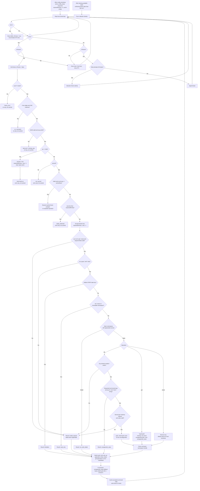

# USB Serial Configuration Protocol

This is the specification of the protocol that reads and changes the board's settings over the USB cable.
The [ESP32 NVS Key-Pair Manager](https://github.com/entr0-pi/arduino-nvs-desktop) desktop app uses it.
You can also drive it from any serial tool or script that follows this document.

How the firmware implements it: [SERIAL COMPANION.md](SERIAL%20COMPANION.md).
How to use the desktop app: [INSTALL.md](../INSTALL.md#usb-configuration).

## 1. At a glance

- The board stores settings in three NVS namespaces: `gnss`, `wifi` and `ntrip`.
- The host sends one request at a time, as a JSON message in a frame with a CRC. The board answers each request with one framed JSON reply.
- There are four operations: `hello`, `get`, `set` and `erase`.
- **Namespaces are fixed, keys are not.** Only `gnss`, `wifi` and `ntrip` are accepted. Within them, the
  protocol has no list of keys: it works on whatever keys the firmware has stored (see [section 7](#7-settings)).
- The protocol **only stores values**. It never reboots the board and never applies a value live (see [section 9](#9-when-changes-take-effect)).
- It is available only in builds with `SERIAL_CONFIG_ENABLE=1` (both release variants).

## 2. Serial port

| Setting | Value |
|---|---|
| Port | The board's USB port. For ESP32-S3 / ESP32-C3, the firmware image must match the port type (see [INSTALL.md](../INSTALL.md#2-find-your-usb-port-type-esp32-s3-and-esp32-c3-only)) |
| Line settings | 115200 baud, 8 data bits, no parity, 1 stop bit (8N1). Native USB ports ignore the baud rate |
| Flow control | None |
| Shared with | Firmware log output. Bytes outside a frame are ignored. A log line written in the middle of a reply corrupts that reply, so builds with this protocol should keep `GLOBAL_LOG_LEVEL=0` |

The GNSS receiver's baud rate (`gnss/baud`) is a different setting, on a different UART.

Opening the port may reset the board, depending on the board. Wait about **2 s** after opening and discard
any bytes received during that time before sending the first request.

## 3. Frame format

```text
STX  JSON payload  '#'  CRC  ETX
0x02 {...}         0x23 4 hex digits 0x03
```

| Part | Rule |
|---|---|
| `STX` | Byte `0x02`. Always starts a new frame, discarding any unfinished one |
| JSON payload | One JSON object, UTF-8. Control characters must be escaped |
| `#` | Separator. The receiver splits on the **last** `#`, so `#` may appear inside the JSON |
| CRC | CRC16 of the JSON payload bytes only, written as 4 hex digits. The board sends uppercase and accepts either case |
| `ETX` | Byte `0x03`. Ends the frame |

**CRC16-CCITT-FALSE:** polynomial `0x1021`, initial value `0xFFFF`, no input or output reflection, no final XOR.
Check value: the ASCII string `123456789` gives `29B1`.

**Size limits**

| Item | Maximum |
|---|---|
| Whole frame, `STX` to `ETX` included | 512 bytes |
| JSON payload | 505 bytes |
| Key name | 15 bytes (at least 1) |
| String value | 256 bytes |

A frame that grows past 512 bytes is dropped without a reply. A frame not finished within **500 ms** of its
`STX` is dropped without a reply. Escaping can make a 256-byte string exceed the frame limit, so check the
encoded size before sending.

## 4. Requests and replies

Every request is a JSON object with:

| Field | Type | Required for | Meaning |
|---|---|---|---|
| `op` | string | all | `hello`, `get`, `set` or `erase` |
| `seq` | integer, 0 to 4294967295 | all | Sequence number (see [section 5](#5-session-and-sequence-numbers)) |
| `ns` | string | `get`, `set`, `erase` | Namespace: `gnss`, `wifi` or `ntrip` |
| `key` | string | `get`, `set`, `erase` | Key name (see [section 7](#7-settings)) |
| `type` | string | `set` | `int`, `uint`, `bool` or `string`. Must match the stored type |
| `value` | JSON value | `set` | New value, already of the right JSON type (see [section 6](#6-value-types)) |

Every reply is a JSON object with:

| Field | Present | Meaning |
|---|---|---|
| `seq` | Always, except for frame errors | The `seq` of the request it answers |
| `op`, `ns`, `key` | On replies to `get`, `set`, `erase` | Copied from the request |
| `status` | Always | `ok` or `error` |
| `type`, `value` | On a successful `get` | Stored type and value |
| `message` | On errors | Error code (see [section 10](#10-error-codes)) |
| `detail` | On some errors | Human-readable reason. Treat a missing `detail` as an empty string |

### Operations

| `op` | Effect | Successful reply |
|---|---|---|
| `hello` | Starts (or restarts) the session. Always succeeds | `{"seq":…,"op":"hello","status":"ok"}` |
| `get` | Reads one key | Includes `type` and `value` |
| `set` | Overwrites one **existing** key, keeping its type | `status: ok` |
| `erase` | Removes one key. Succeeds even if the key is already missing. **Resets the whole namespace to defaults at the next boot** (see [section 8](#8-rules-enforced-by-the-board)) | `status: ok` |

Any other `op` (for example `restart` or `apply`) is refused with `invalid_request`.

### Example exchange

Shown without the `STX` / `ETX` bytes:

```text
→ {"op":"hello","seq":0}#16B0
← {"seq":0,"op":"hello","status":"ok"}#BABF

→ {"op":"get","seq":1,"ns":"gnss","key":"baud"}#6E3C
← {"seq":1,"op":"get","ns":"gnss","key":"baud","type":"uint","value":115200,"status":"ok"}#4B01

→ {"op":"set","seq":2,"ns":"gnss","key":"baud","type":"uint","value":230400}#730B
← {"seq":2,"op":"set","ns":"gnss","key":"baud","status":"ok"}#62BB

→ {"op":"set","seq":3,"ns":"gnss","key":"baud","type":"int","value":230400}#C0E7
← {"seq":3,"op":"set","ns":"gnss","key":"baud","status":"error","message":"invalid_request","detail":"type mismatch: uint expected"}#E4C6
```

## 5. Session and sequence numbers

The board accepts commands only after a `hello` since its last boot. Before that, every `get`, `set` or
`erase` gets `not_synced`.

| The board receives | It does |
|---|---|
| `hello` with any `seq` | Accepts, expects `seq + 1` or higher next, forgets the cached reply |
| A command whose `seq` equals the last accepted command's `seq` | Resends the cached reply, byte for byte. **Does not run the command again** |
| A command whose `seq` is lower than expected | Refuses with `replay_detected` |
| A command whose `seq` is equal to or higher than expected | Runs it. Gaps are allowed |

So the host must:
- send `hello` first, then increase `seq` by at least 1 for every new command;
- resend the **exact same frame** (same `seq`) when a reply is lost. The board then replies again without
  repeating the write.

The board keeps only one cached reply, in RAM. A reboot clears it, along with the session.

## 6. Value types

| Protocol `type` | NVS type on the board | JSON value |
|---|---|---|
| `int` | signed 32-bit (`I32`) | Integer from -2147483648 to 2147483647 |
| `uint` | unsigned 32-bit (`U32`) | Integer from 0 to 4294967295 |
| `bool` | 8-bit (`U8`) | `true` or `false` |
| `string` | string (`STR`) | String of at most 256 bytes |

The board does not convert types: `"115200"` (a JSON string) is refused for a `uint` key. `float` and
other NVS types are refused with `unsupported_value`.

## 7. Settings

The protocol does not hard-code these keys. `get`, `set` and `erase` accept any key name, and `set`
succeeds only on a key that already exists in NVS. The keys that exist are the ones the firmware writes at
boot, listed below for the current firmware. If a future firmware adds a key, the protocol handles it with
no change. The namespace list (`gnss`, `wifi`, `ntrip`) and the three hidden keys are the only names built
into the protocol.

Defaults are the values written on first boot, and after an `erase` (at the next boot).

### `gnss`: GNSS receiver UART. Applied at the next boot

| Key | Type | Default | Meaning |
|---|---|---|---|
| `rx_pin` | int | `-1` | ESP32 pin receiving data from the GNSS. `-1` = not set |
| `tx_pin` | int | `-1` | ESP32 pin sending data to the GNSS. `-1` = not set |
| `baud` | uint | `0` | GNSS UART baud rate. `0` = not set |

While any of the three is "not set", the GNSS UART stays off.

### `wifi`: Wi-Fi station. Applied at the next boot

| Key | Type | Default | Meaning |
|---|---|---|---|
| `ssid` | string | `CHANGEME` | Network name |
| `pass` | string | `CHANGEME` | Network password |
| `dhcp` | bool | `true` | `true` = get the address by DHCP. `false` = use the four keys below |
| `ip` | string | `0.0.0.0` | Static IP address |
| `gw` | string | `0.0.0.0` | Gateway |
| `subnet` | string | `0.0.0.0` | Subnet mask |
| `dns` | string | `0.0.0.0` | DNS server |
| `accesspoint` | bool | `true` | Also start the board's own access point (only in builds with `WIFI_DUAL_MODE=1`) |

### `ntrip`: RTK correction client. Applied within about 5 s

| Key | Type | Default | Meaning |
|---|---|---|---|
| `enabled` | bool | `false` | Run the NTRIP client |
| `host` | string | *(empty)* | Caster host name |
| `port` | uint | `2101` | Caster port |
| `mount` | string | *(empty)* | Mountpoint |
| `user` | string | *(empty)* | User name |
| `pass` | string | *(empty)* | Password |
| `max_tries` | int | `5` | Failed connection attempts before the client gives up |
| `retry_delay` | uint | `30000` | Delay between attempts, in ms |
| `health_to` | uint | `60000` | Reconnect if no valid data for this long, in ms |
| `passive_ms` | uint | `5000` | Interval between passive checks of the incoming stream, in ms |
| `req_valid` | uint | `3` | Valid RTCM frames required to accept the stream |
| `buf_size` | uint | `1024` | Receive buffer size, in bytes |
| `conn_to` | uint | `5000` | Connection timeout, in ms |
| `send_gga` | bool | `false` | Send the receiver's position (GGA) to the caster |

`lock_fails`, `lock_aband` and `lock_hash` also exist in `ntrip`. They hold the client's internal state, not
settings, and every operation on them is refused with `forbidden`.

## 8. Rules enforced by the board

The board checks a command in this order and stops at the first failure:

1. `op` is `get`, `set` or `erase`, `key` is 1 to 15 bytes and, for `set`, `type` is known → else `invalid_request`
2. `ns` is `gnss`, `wifi` or `ntrip` → else `invalid_request`
3. The key is not one of the hidden `lock_*` keys → else `forbidden`
4. For `set` and `erase`: the namespace is not locked by the build → else `read_only`
5. The namespace opens → else `nvs_write_failed`
6. For `set`: the key already exists, its stored type is supported and equals `type`, and `value` has that type → else `invalid_request` or `unsupported_value`

**Locked namespaces.** A namespace is locked (`read_only` on `set` / `erase`) when the build fixes its values:
`gnss` with `FORCE_HARDCODED_UART=1`, `wifi` with `FORCE_WIFI_SECRETS=1` or no Wi-Fi in the build,
`ntrip` with `NTRIP_CLIENT_ENABLE=0`. A locked namespace is never written to NVS, so `get` on it usually
returns `nvs_write_failed` (detail `namespace open failed`) or `not_found`. In the release binaries, only
`wifi` and `ntrip` of the **BLE only** variant are locked.

**`set` only overwrites keys that already exist.** It cannot create a key or change a key's type.
If a key is missing (for example after `erase`), `set` is refused until the next boot restores it.
`ntrip/send_gga` is the exception: the next boot does **not** restore it on its own. It comes back
when the NTRIP settings are saved from the Web UI.

**`erase` resets the whole namespace.** At boot, the firmware checks that every key of each namespace is
present. If one is missing, it rewrites **all** keys of that namespace with their defaults. Erasing
`wifi/dns`, for example, also resets `ssid` and `pass` to `CHANGEME` at the next boot. (`ntrip/send_gga`
is not part of this check.)

**No range checks.** `set` checks only the key, the type and the JSON value type. It does not run the
checks the Web UI does, so the board stores what it is given:
- `gnss`: pins and baud are used as stored at the next boot. A wrong value (for example `rx_pin` equal to
  `tx_pin`) is applied as is. On the ESP32-C3, GPIO 18 and 19 are the USB data lines: using them for the
  GNSS UART cuts the USB link after the next boot.
- `ntrip`: an out-of-range value (for example `buf_size` = `0`) goes live within seconds. `port` is used
  as a 16-bit number, so a value above 65535 wraps around (70000 becomes 4464).
- `wifi`: wrong values only show at the next boot, when the board fails to join the network.

Passwords (`wifi/pass`, `ntrip/pass`) can be read back with `get`.

## 9. When changes take effect

| Namespace | Takes effect |
|---|---|
| `ntrip` | Within about 5 s, while the board has internet access. `enabled` starts or stops the client. A change of `host`, `port`, `mount`, `user`, `pass` or `max_tries` restarts it. Other keys apply at its next restart. Any change also clears the client's give-up state |
| `gnss`, `wifi` | At the next boot |

The protocol cannot reboot the board. Press the reset button, power-cycle it, or use the Web UI's restart.

After a reboot:
- **The USB port stays open** (common with a USB-to-UART chip): the next command gets `not_synced`. It was
  not run, so send `hello` and then the command again with a new `seq`.
- **The USB port disappears and comes back** (common with native USB): the host gets a read or write error.
  Close the port, reopen it, wait the boot delay and send `hello`.

In both cases, a request sent just before the reboot may or may not have been saved. Read the key back with
`get` to be sure.

## 10. Error codes

| `message` | `seq` in reply | Cached | Cause | What the host should do |
|---|---|---|---|---|
| `frame_error` | No | No | No `#` in the frame | Resend the same frame |
| `crc_mismatch` | No | No | CRC field is not 4 hex digits or does not match | Resend the same frame |
| `bad_json` | No | No | Payload is not valid JSON | Resend the same frame. If it keeps failing, fix the request |
| `missing_seq` | No | No | `seq` missing or not an integer from 0 to 4294967295 | Fix the request |
| `not_synced` | Yes | No | No `hello` since the board booted | Send `hello`, then the command again with a new `seq` |
| `replay_detected` | Yes | No | `seq` lower than the board expects | Send `hello` to resynchronize, or use a higher `seq` |
| `invalid_request` | Yes | Yes | Unknown `op`, namespace or key, bad key length, wrong `type`, value of the wrong JSON type. See `detail` | Fix the request |
| `forbidden` | Yes | Yes | Hidden `ntrip/lock_*` key | Do not use these keys |
| `read_only` | Yes | Yes | `set` / `erase` on a namespace locked by the build | Not changeable on this build |
| `not_found` | Yes | Yes | `get` on a key that is not stored | Key is missing. It returns at the next boot (except `ntrip/send_gga`) |
| `nvs_write_failed` | Yes | Yes | Namespace could not be opened, or the write failed | Retry with a new `seq`. If it persists, check the namespace is not locked |
| `unsupported_value` | Yes | Yes | `float` or another unsupported type, stored string over 256 bytes, or a reply too large for one frame | Do not retry |

"Cached" replies are resent unchanged if the same `seq` arrives again.

Known limitation: writing an empty string (`""`) always reports `ok`, even if the write failed. Read it
back with `get` when it matters.

## 11. Recommended host behavior

These are the timings the desktop app uses. Other hosts should follow them or measure their own board.

| Step | Value |
|---|---|
| Wait after opening the port, then discard received bytes | 2 s |
| Wait for a reply, counted from the end of the write | 1 s |
| Attempts per request (same frame each time) | 3 |

For each request:
1. Encode the frame once, with a new `seq`.
2. Send it and read frames until one arrives with the same `seq`. Ignore frames with a bad CRC or another
   `seq` (late replies to earlier requests).
3. If no matching reply arrives in time, or a reply has no `seq` (frame error), send the **same** frame
   again. After 3 attempts, report "no reply": the write may or may not have been saved.
4. On `not_synced`, send `hello` and retry once with a new `seq`.

Send one request at a time. Wait for its reply (or for its attempts to run out) before sending the next.

## Appendix: board receiver flowchart

The node ids (`[G4]`, `[PMATCH]`...) are referenced in the comments of
[src/serial_config.cpp](../src/serial_config.cpp).


